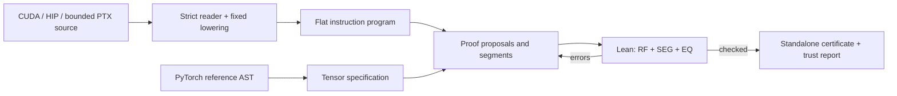

# LARK

An independent implementation of the verification workflow in
[LARK: Lean-Assisted Reasoning for LLM-Generated GPU Kernels](https://arxiv.org/abs/2611.02028)
(Zhang et al., 2026).

**This repository implements restricted CUDA/HIP/PTX profiles of the method.**
It is not the authors' code or a full reproduction of their KernelCraft results.
It produces real, standalone Lean certificates for the supported kernels. The
paper's broader PTX, tensor-core, and production-kernel coverage
is outside this implementation. [The implementation map](docs/paper.md)
records the correspondence and differences.

The [bounded PTX extension](reproduction/ptx/README.md) certifies four independent
tiny float32 programs in the same machine. It has CPU-only NVIDIA assembly
checks and no NVIDIA execution evidence; optimized PTX and collectives remain
outside its supported subset.

The opt-in [full-wave HIP shuffle profile](reproduction/shuffle/README.md)
adds snapshot register transport to the Lean machine. Five independent 64-lane
kernels have whole-launch certificates and exact-source checks on both MI350X
hosts. Shuffles add no memory ordering; partial masks and tensor cores remain
unsupported.

The opt-in [native MFMA profile](reproduction/mfma/README.md) certifies a complete
64-lane 16×16 instruction tile and checks the exact source on both MI350X hosts.
It covers one AMD half-input/float-output matrix instruction with default
modifiers. Other matrix forms and original optimized kernels remain outside
that profile.

The [small upstream-derived vLLM activation study](reproduction/production_activation/RESULTS.md)
adds HIP/CUDA certificates for one scalar FP16 SiLU-and-mul adaptation, with its
intermediate half rounding retained. Both MI350X hosts match an extracted
upstream scalar specialization and CPU PyTorch on the finite test set. The
paper's original production sources and results remain unavailable.

The [multiwave scalar SiLU extension](reproduction/production_silu/RESULTS.md)
retains the native 1,024-thread blocks and strided loop, with whole-launch proofs
at three device-test shapes and two symbolic-only billion-cell extremes.
Eight HIP/CUDA certificates were independently rechecked. Both MI350X hosts
matched the extracted upstream path bit for bit across 2,966,860 outputs each.

An [optional Mathlib real interpretation](lean-real/README.md) connects the
existing SiLU/dot-product launch proofs to canonical formulas and proves
reduction-tree and chunking algebra. The [full-wave reduction extension](reproduction/wave_reduction/RESULTS.md)
uses it to prove a complete native wave64 butterfly against an independent real
sum. Both hosts matched the source expression tree on 17,408 outputs each;
cancellation disagreements with CPU Torch are reported separately. These
independent additions do not reproduce the original paper's experiments.

The [native weighted RMSNorm study](reproduction/production_rmsnorm/RESULTS.md)
adds whole-launch canonical-real certificates at width 16,384 and native
1,024-thread/wave64 geometry. Four exports cover 1, 3, 64 and 255 rows; the
underlying theorem quantifies over every input and initial outside memory for
all `1 <= rows < 256`. It proves actual execution, actual-trace race freedom
and every reference output, including both block barriers and the logical-16
scale reduction inside physical wave64. Both MI350X hosts passed numerical
tolerance checks. Signed-zero and one-half-ULP differences remain recorded;
the certificate does not assert IEEE equivalence or a floating-point error bound.

The [native FlashInfer RMSNorm development](reproduction/production_flashinfer_rmsnorm/README.md)
adds full-source binding and universal address/ownership components for its
distinct logical32 reduction. Both AMD hosts pass 127,008,768 CPU float64
comparisons; the complete outputs, recorded rounding differences and nine
numerical rejection controls have a public standalone replay. Complete source
execution and dense-real proofs remain pending, with zero registered FlashInfer
certificates.

The separate [in-place fused add RMSNorm study](reproduction/production_fused_rmsnorm/README.md)
now proves the complete native seeded-inout launch and connects both extracted
buffers to an independent canonical-real reference. It covers all `1 <= rows < 256`
at width 16,384 and 1,024-thread/wave64 geometry, including both logical32
reductions/barriers, source scheduling, halt and actual-trace race freedom.
The source-order theorem retains arbitrary arithmetic operations; the
[real interpretation](reproduction/production_fused_rmsnorm/REAL.md) proves the
full reduction covers all columns and both buffers equal the reference.
The `verify-native-fused-rmsnorm` command exports the closed source-bound profile.
Both AMD hosts have finite numerical evidence. Half conversions are identities
in the real theorem. IEEE/rounding guarantees are outside the paper's formal
scope; original production results remain unreproduced.

The separate [native llm.c softmax study](reproduction/production_softmax/README.md)
binds the complete three-pass original and repaired sources to their scalar IR,
checks the paper's clamped-read conflict at instruction level, and replays both
complete finite address traces. Both full sources have constructive complete
block proofs. The repair also has a source-bound whole-grid correctness and
race-freedom proof for every supported shape under the original fuel, retaining
all converted outputs. An optional pinned-Mathlib proof connects that actual
launch to canonical real softmax, with identity half conversions and an
arbitrary finite seed. Both variants pass finite numerical checks on both AMD
hosts. The original has a proved reached conflicting pair and a complete racy
one-row launch that cannot satisfy `Correct` for any reference. Floating-point
behavior is tested numerically outside the exact-real theorem, following the
paper's stated scope. This development profile issues no registered softmax
source certificate.

The [native in-place vLLM RoPE study](reproduction/production_rope/README.md)
proves the complete 512-thread launch, both Q/K strided loops, actual-trace race
freedom and both extracted buffers against a dense reference for either rotary
layout at `1..65535` rows. The theorem retains arbitrary scalar operations and
explicit half conversions. Eight registered source certificates and fresh
rechecks pass through `verify-native-rope`. Both AMD hosts pass 79,626,240 fresh
CPU float64/Torch FP32 comparisons, with zero tolerance or bit differences.
This independent adaptation does not recover the original paper's artifacts
or measurements.

The separate [native fused Q/K normalization and RoPE development](reproduction/production_qknorm_rope/README.md)
retains the 256-thread launch and logical32 reductions inside physical wave64,
then rotates the normalized values and writes Q/K out of place as the paper
specifies. Both full source layouts, address coverage, ownership and index bounds
are Lean checked. Paired AMD runs pass 79,626,240 CPU-reference comparisons, with
zero adapted/upstream bit differences. Both complete native layouts now have
Lean proofs of execution, actual-trace race freedom and equality to independent
dense exact-real references, with source-bound certificate export and rechecking.

The separate [online-attention study](reproduction/online_attention/README.md)
proves the tiled normalized value recurrence equals dense softmax over reals.
Both MI350X hosts also passed 749,568 combined numerical comparisons for the
unchanged upstream FP32 kernel. That upstream FP32 study adds no source certificate.
The later [native FP16 development](reproduction/online_attention/NATIVE.md)
adds the full tiled source, checked address/ownership components and paired
both-host numerical evidence. Its [first-block proof](reproduction/online_attention/BLOCK.md)
checks actual setup, output zeroing, full first K/V copies and barrier resumption
under the native scheduler. A later [compute-prefix proof](reproduction/online_attention/WEIGHTS.md)
extends each lane through its first query row's scores and exponential
denominator. The [output-prefix proof](reproduction/online_attention/OUTPUT.md)
joins those computations to all 256 output stores for the first query row and
first key tile. The [first-key block proof](reproduction/online_attention/FIRST_KEY_BLOCK.md)
then composes all four query rows and all 32 lanes through the second block
barrier and resume. The [whole-launch proof](reproduction/online_attention/WHOLE_LAUNCH.md)
now covers all four key tiles, all blocks and the final halt, with actual-trace
race freedom and every output extracted. A separate canonical-real theorem
connects this unchanged native source to dense 128-key, 256-component SDPA for
all `1 <= groups <= 65535`; four source-bound exports cover groups 1, 3, 64 and
65535. This idealization treats storage casts as identities and asserts no IEEE
equivalence or floating-point error bound. Original author artifacts and
historical model/H100 results remain unreproduced.

[The reproduction study](reproduction/README.md) adds CPU proof/mutation experiments,
an upstream softmax race witness, and actual AMD MI300X measurements at the paper's
17 workload dimensions. All model calls remain offline/free. The large FP16 HIP
benchmarks are numerically tested; the reduced float32 kernels have Lean certificates.
See [the measured results](reproduction/RESULTS.md) for the coverage and limitations.

[The MI350X extension](reproduction/nonlinear/README.md) adds nonlinear operations
and explicit FP16 storage conversions in a separately pinned Lean model, with
reduced fixtures for all 17 families. These abstract-operation certificates are
distinct from numerical tests of the large FP16 benchmarks and from IEEE proofs.

Induction extensions certify **all seventeen full-size workload families** in the same
machine: [ReLU/SiLU/GELU](reproduction/pointwise/README.md),
[GEMV](reproduction/reduction/README.md), [GEMM/batched GEMM](reproduction/matrix/README.md),
[Linear with bias](reproduction/linear/README.md), [interleaved RoPE](reproduction/rotary/README.md),
[Conv2D/depthwise convolution](reproduction/convolution/README.md),
[RMSNorm/LayerNorm/Softmax](reproduction/normalization/README.md),
[two-launch FFN](reproduction/feedforward/README.md),
[FP32-projection SwiGLU](reproduction/swiglu/README.md), and
[dense SDPA/GQA](reproduction/attention/README.md).
These are independent programs at all twelve Level-1 and five Level-2 workload
shapes. The dense SDPA adaptation does not implement FlashAttention's online
algorithm or the original optimized PTX kernel.
The [completed offline model comparison](reproduction/local_models/results/model-comparison-20261109/README.md)
audits all 17 reduced fixtures for GLM, Flash and DeepSeek, including every
failed attempt, reported token counts and freshly rechecked model proofs.
The [full-shape ledger](reproduction/FULL_SHAPE.md) audits 34 independently rechecked
certificates and 170 exact-source trials per host.
Every profile has separate CUDA/HIP certificates and exact-source HIP checks on
both MI350X hosts. The scalar programs and one-thread blocks differ from the
paper's optimized programs and launches.

Symbolic scaling includes million-term dot products and billion-cell output
footprints with small standalone certificates. Those largest arrays were not
allocated or executed. A [same-source dot-product ablation](reproduction/dot_ablation/RESULTS.md)
compares flat proof execution with loop induction. See the [paper coverage ledger](reproduction/COVERAGE.md)
for original pass rates, kernels, timings and other results that remain missing.
The [updated result-by-result source audit](reproduction/paper_results/snapshots/20261112-v20/results/RESULTS.md)
maps every paper table and figure to published evidence and concrete dependencies;
all original paper results have not been reproduced.

The pipeline reads a kernel and a separately written PyTorch reference,
constructs a flat machine program, checks race freedom, verifies a proposed
segmentation, and proves the result equals the reference. Python preflight
can reject a candidate; acceptance requires Lean, successful proofs, and an
axiom audit. Proofs quantify over **all input values** at the declared shapes,
and all initial contents of memory outside the input regions.



## Run an example

Requires Python 3.11+ and **Lean 4.19.0**. No GPU, Mathlib, or Python runtime
dependencies are needed to verify a kernel. Install Lean using
[the official Lean installation instructions](https://lean-lang.org/install/)
and ensure `lean` and `lake` are on `PATH`.

```bash
git clone https://github.com/harsh-nod/lark.git
cd lark
python3 -m pip install -e .

lark verify examples/vector_add/kernel.cu \
  --reference examples/vector_add/reference.py \
  --task examples/vector_add/task.json \
  --output certificates/vector_add

lark check certificates/vector_add
```

Use `python3 -m lark_kernels` instead of `lark` if another installed package owns that
command. Set `LARK_LEAN=/absolute/path/to/lean` or pass `--lean` to select a
toolchain. `verify` requires a new output directory, so a failed run cannot
silently reuse an old certificate.

The output contains the original kernel, reference, signature and launch,
lossless token data, flat program, segmentation and proof proposals, a pinned
machine model embedded in `Main.lean`, checker logs, SHA-256 artifact hashes,
and `report.json`. The report lists the trust boundary and the actual axioms
of each proof.

A [checked vector-add certificate](examples/vector_add/certificate) is included
so the standalone proof can also be inspected and rebuilt immediately.

Recheck without installing this Python package:

```bash
cd certificates/vector_add
lake build
# Alternatively, with Lean 4.19.0 already selected:
lean Main.lean
```

`lark check` additionally regenerates the fixed theorem statement and checks
that the source, signature, reference, model, and proposal still bind to it.
`lake build` checks the exported Lean theorem itself.

## Included kernels

| Example | Language | What it exercises |
| --- | --- | --- |
| `vector_add` | CUDA | Multiple blocks and disjoint output ownership |
| `relu` | HIP | Exact maximum and HIP launch metadata |
| `saxpy` | CUDA | Constants and scalar arithmetic |
| `fused_relu` | CUDA | Register temporaries and fused operations |
| `reverse` | CUDA | Shared-memory staging and a block barrier |
| `block_sum` | CUDA | Separate shared memory per block and guarded writes |
| `matmul` | CUDA | Integer division/remainder, counted `while`, accumulation |

Examples deliberately use small shapes so the full symbolic execution is
tractable in Lean's kernel. They are correctness demonstrations, not tuned
performance kernels. Run all examples and mutation tests with:

```bash
python3 -m unittest discover -s tests -v
```

Proof integration tests skip if Lean is absent. CI installs the pinned
toolchain and runs them. `tools/verify_examples.py` exports all example
certificates to a new directory. Optional CPU comparisons against installed
PyTorch are available with `python3 tools/check_torch.py`; these are numerical
tests, separate from the proofs. Additional GPU measurements and finite scalar
calibration samples are documented in the reproduction study.

## Supported input

The task JSON fixes argument order, buffer roles and shapes, language, launch,
and four fuel bounds. See [the task format](docs/input.md).

- Contiguous, disjoint `float32` or `float16` buffers; static float shared arrays.
- Scalar `+`, `-`, `*`, `/`, `fmaxf`, `expf`, `tanhf`, `rsqrtf`; float registers.
- Explicit `__half2float`/`__float2half`; implicit half arithmetic is refused.
- Nonnegative integer indices within signed int32 range; `+`, `-`, `*`, `/`, `%`.
- One-dimensional launches, integer comparisons, braced `if`/`else`, and `while`.
- `__syncthreads()` and CUDA `__syncwarp()` on complete warps.
- References using arithmetic with fixed-shape broadcasting, ReLU, maximum,
  reshape, sum, flip, rank-2/rank-3 matmul, and grouped valid conv2d.

Unsupported operations, overflow, missing initialization, invalid bounds,
exhausted fuel, and divergent synchronization cause refusal. Even same-value
conflicting writes count as races. A block barrier never orders different
blocks. Atomics, asynchronous operations, general pointer arithmetic, float-based
control flow, and tensor-core collectives are refused. PTX has its separate,
narrower [instruction and addressing subset](reproduction/ptx/README.md).

Arithmetic is interpreted through universally quantified scalar operations.
This establishes equivalence for an exact real interpretation, without
formalizing IEEE rounding or proving numerical error bounds. This
profile requires matching scalar expression structure: algebraically
equivalent rearrangements can be refused. Rejection is not proof of a bug.

## Proof-provider loop

The default prover proposes barrier-delimited segments and deterministic Lean
tactics. To attach an external LLM prover, explicitly supply a local command:

```bash
lark verify examples/vector_add/kernel.cu \
  --reference examples/vector_add/reference.py \
  --task examples/vector_add/task.json \
  --output certificates/with_provider \
  --proposal my_initial_proposal.json \
  --provider 'python3 tools/http_prover.py' --attempts 3
```

A failed check sends JSON containing the current proposal, fixed Lean source,
and errors to the command's stdin. It returns replacement segments and three
proof bodies. It cannot change the theorem statement or signature. Every
attempt is checked again; admissions, declaration injection, unchecked native
evaluation, and nonstandard axioms are rejected. Provider commands are local
programs you choose to execute; this is not a sandbox for malicious executables.

The optional HTTP adapter reads `LARK_PROVER_URL` (a complete chat-completions
endpoint), `LARK_PROVER_MODEL`, and optionally `LARK_PROVER_API_KEY` from the
environment. No provider, network call, or model delegation occurs by default.
See [the provider protocol](docs/providers.md).

## Trust and scope

The machine semantics, Python parsers and lowering, reference formalization,
host interface, Lean, and the phase-reduction metatheory are trusted and listed
in each report. The reproduction study compares four scalar operations on finite
MI300X samples; it does not establish full hardware conformance. Python source
lowering has not been formalized in Lean. The lossless token round trip detects byte loss; it does
not prove semantic correctness of the lowering. See [the trust model](docs/trust.md).

The source implementation is MIT licensed. The paper is cited for the design;
its prose, figures, and implementation have not been copied into this repository.
