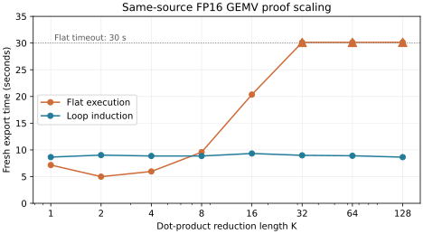

# Same-source dot-product proof ablation

Run date: 2026-11-09. **Independent experiment, zero model calls.**

Both methods read the identical HIP source, reference and task bytes for FP16
GEMV `[2,K] @ [K,1]`. The flat method uses concrete symbolic execution and the
default proof slots; induction uses the counted-loop/grid lemmas. Each method
proves the existing nonlinear machine's completion, race freedom and reference
agreement for every input and outside memory. Every successful export was
independently rechecked. Sources/statements are hash-bound in [results/](results/).

| K | Flat outcome | Flat verify s | Induction outcome | Induction verify s | Flat / induction Lean bytes |
| ---: | --- | ---: | --- | ---: | ---: |
| 1 | verified | 7.161 | verified | 8.651 | 18,594 / 67,123 |
| 2 | verified | 4.990 | verified | 9.022 | 18,962 / 67,123 |
| 4 | verified | 5.961 | verified | 8.859 | 19,698 / 67,123 |
| 8 | verified | 9.572 | verified | 8.857 | 21,183 / 67,123 |
| 16 | verified | 20.360 | verified | 9.325 | 24,188 / 67,133 |
| 32 | unproved (30 s limit) | 30.128 | verified | 8.983 | 30,205 / 67,133 |
| 64 | unproved (30 s limit) | 30.132 | verified | 8.901 | 42,294 / 67,133 |
| 128 | unproved (30 s limit) | 30.141 | verified | 8.643 | 66,731 / 67,143 |

Induction verified and independently rechecked all eight sizes. Flat verified
through K=16, then reached the 30-second limit at K=32,64,128. A timeout is an
incomplete proof, not evidence that the theorem is false or that flat execution
could never prove it. Neither method changes the kernel, geometry or reference.

These are single measurements on one CPU environment, not a statistical speed
benchmark. Verify time includes fresh Python/Lean elaboration and excludes the
separate recheck. The larger inductive export embeds its generic proof library;
its size stays near 67 KB while the flat trace/expressions grow with K. Operation
semantics, source/spec readers and external GPU-interleaving correspondence retain
the same trust boundaries as the other studies. No GPU was used here.

This does not recreate the authors' agent segmentation/flat prompts, optimized
kernels, budgets, token counts or original ablation results.
