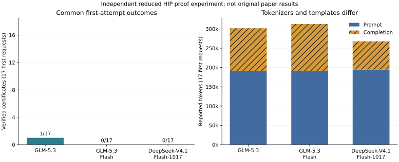

# Completed independent three-model comparison

**The original paper is not fully reproduced.** All three local cohorts have
finished the same 17 reduced HIP fixtures under our bounded proof-slot harness.
The [complete audit](progress/completed-three-model-audit/comparison.json)
reconstructs every request history and verifies identical decoded first-request
messages across models. Both successful model-generated certificates passed
fresh source-bound Lean rechecks.

The [complete tables, SVG and scope](reports/completed-three-model-comparison/RESULTS.md)
are generated from that audit. The renderer independently rebuilt the audit
from raw records and rechecked the successful certificates again.

| Local checkpoint | First-attempt certificates | Reported first-attempt tokens | Certificates within recorded budget | All requests | All reported tokens |
| --- | ---: | ---: | ---: | ---: | ---: |
| GLM-5.3 | 1 / 17 | 301,608 | 1 / 17, up to 3 requests/case | 49 | 832,937 |
| GLM-5.3-Flash | 0 / 17 | 312,772 | 0 / 17, 1 request/case | 17 | 312,772 |
| DeepSeek-V4.1-Flash-1017 | 0 / 17 | 267,821 | 1 / 17, up to 3 requests/case | 51 | 821,063 |

Only first requests are matched across models. Different retry budgets remain
separate. GLM proved SiLU on its first request; DeepSeek proved depthwise
convolution on its third request. No posthoc tactic repair is counted.
GLM reached Lean 36 times, Flash seven times and DeepSeek 37 times. Proposal
refusals remain distinct from unproved Lean checks and are not kernel-bug
diagnoses. Usage is complete for these cohorts. Hosted API spending is zero;
tokenizers, templates, precision and parallelism differ, so this does not
isolate a model-size effect or reproduce billed costs.

Full GLM's raw records are split into the completed
[initial three cases](glm53-budget4096-remote/results.json),
[first additional seven](glm53-budget4096-half-a-remote/results.json) and
[final seven](glm53-budget4096-half-b-remote/results.json).
Their individual audits are retained under [progress](progress/).
All previously published case bytes and launch records were preserved.
The earlier partial SiLU audit remains historical evidence; the complete
comparison now covers the whole cohort.

Flash's [first additional seven](flash17-budget4096-half-a-remote/results.json)
and [final seven](flash17-budget4096-half-b-remote/results.json), together with
its [earlier three cases](../pilot-glm-flash-budget4096-20261109/), cover all
17 fixtures once. DeepSeek's [complete cohort](../../DEEPSEEK_RESULTS.md)
combines its initial three cases with the additional fourteen. The earlier
[two-model audit](progress/completed-deepseek-flash-audit/comparison.json)
remains a historical snapshot rather than a replacement for the complete audit.

The [full GLM lifecycle record](progress/glm53-lifecycle-stopped.json) confirms
that its exact owned container stopped with exit code zero after all 17 cases
finished, all controllers exited, raw records were copied/audited and active
and waiting requests reached zero. [Final runtime evidence](glm53-final-runtime/)
retains its unchanged historical readiness record, final logs and metrics.
Both earlier DeepSeek and Flash services were also stopped after their work.
Weights and source snapshots remain available for offline reruns.

The executed proof controller is the hash-pinned
[budget snapshot](../pilot-deepseek-budget4096-20261109/budget-controller-source.tar.gz),
extended with the disjoint [additional fixture snapshot](../pilot-deepseek-expanded-20261109/additional-cases-source.tar.gz).
Running controllers and fixtures were never edited. Earlier reasoning-only,
low-effort and incomplete transport pilots remain separate. The
[comments-only replay](../../COMMENT_REPLAY_RESULTS.md) changed no raw counts;
both transformed DeepSeek candidates remained unproved.

The [comparison method](../../COMPARISON_METHOD.md) records all integrity checks.
This is an independent reduced-fixture result, not the original KernelCraft
registry, agent, kernels, model outcomes, stage costs or paper pass rates.
