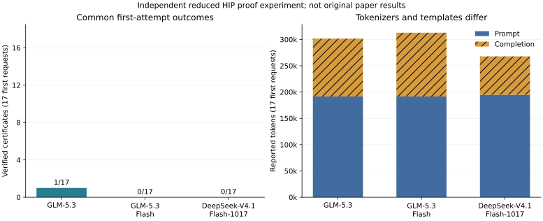

# Independent local three-model comparison

**The original paper is not fully reproduced.** These are the same 17 reduced HIP
fixtures under a bounded immutable-proof-slot harness. Models received identical
decoded first-request messages, seed 261102028, temperature zero, a 16,384-token
output cap and a 4,096 reasoning-token limit. Every successful exported model
proposal passed another source-bound Lean recheck.

| Local checkpoint | First-attempt certificates / fixtures | Responses / requests | Reported first-attempt tokens |
| --- | ---: | ---: | ---: |
| GLM-5.3 | 1 / 17 | 17 / 17 | 301,608 |
| GLM-5.3-Flash | 0 / 17 | 17 / 17 | 312,772 |
| DeepSeek-V4.1-Flash-1017 | 0 / 17 | 17 / 17 | 267,821 |

Only the first request per fixture is compared above. Later retries are
separate: full GLM and DeepSeek allow up to three requests per fixture, while
Flash allows one. These different budgets must not be pooled into a matched rate.

| Local checkpoint | Maximum requests per fixture | Certificates within recorded budget | Actual requests | Actual Lean checks | All-attempt reported tokens |
| --- | ---: | ---: | ---: | ---: | ---: |
| GLM-5.3 | 3 | 1 / 17 | 49 | 36 | 832,937 |
| GLM-5.3-Flash | 1 | 0 / 17 | 17 | 7 | 312,772 |
| DeepSeek-V4.1-Flash-1017 | 3 | 1 / 17 | 51 | 37 | 821,063 |

| Local checkpoint | First-attempt outcomes |
| --- | --- |
| GLM-5.3 | invalid-proposal: 6; proved: 1; unproved: 10 |
| GLM-5.3-Flash | invalid-proposal: 10; unproved: 7 |
| DeepSeek-V4.1-Flash-1017 | invalid-proposal: 6; unproved: 11 |

| Local checkpoint | First certificates in 12 Level-1 families | First certificates in 5 Level-2 families | Certificates within budget (request count) |
| --- | ---: | ---: | --- |
| GLM-5.3 | 1 / 12 | 0 / 5 | silu (1) |
| GLM-5.3-Flash | 0 / 12 | 0 / 5 | none |
| DeepSeek-V4.1-Flash-1017 | 0 / 12 | 0 / 5 | depthwise_conv (3) |

Family names match the paper's workload categories; their kernels, shapes
and verification protocol remain independent reduced adaptations.

| Reduced fixture | GLM-5.3 first outcome | Flash first outcome | DeepSeek first outcome |
| --- | --- | --- | --- |
| batchmatmul | invalid-proposal | invalid-proposal | unproved |
| conv2d | invalid-proposal | invalid-proposal | invalid-proposal |
| depthwise_conv | unproved | invalid-proposal | unproved |
| ffn | unproved | invalid-proposal | invalid-proposal |
| flash_attn | unproved | unproved | invalid-proposal |
| gelu | invalid-proposal | unproved | unproved |
| gemm | invalid-proposal | invalid-proposal | unproved |
| gemv | unproved | unproved | unproved |
| gqa | unproved | unproved | invalid-proposal |
| layernorm | unproved | invalid-proposal | invalid-proposal |
| linear | invalid-proposal | invalid-proposal | unproved |
| relu | unproved | unproved | unproved |
| rmsnorm | unproved | unproved | invalid-proposal |
| rope | unproved | unproved | unproved |
| silu | proved | invalid-proposal | unproved |
| softmax | invalid-proposal | invalid-proposal | unproved |
| swiglu | unproved | invalid-proposal | unproved |

Transport failures, empty final responses and invalid proposals are distinct
from unproved Lean checks. The recorded validator also forbids comments and
`native_decide`; a proposal refusal is not proof of a kernel bug. No posthoc
tactic repair is counted. Unknown usage remains incomplete rather than zero.

Tokens are server-reported prompt/completion counts, not billed costs. Tokenizers,
chat templates, native precision and tensor parallelism differ. GLM uses low
reasoning effort; DeepSeek has no equivalent effort field. This is one seeded
first request per fixture, with no repeated-run uncertainty estimate or isolated
model-size conclusion. Hosted API spending is $0; GPU/electricity cost is not estimated.

The original kernels, registry, prompts, agent tools, budgets and hosted-model
outcomes remain unavailable. These results do not reproduce their pass rates,
stage token costs or model-size conclusions. The input audit JSON binds every
raw source file and independent Lean recheck; the render manifest binds this report.
